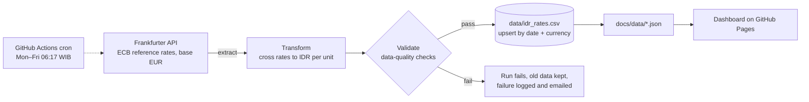

# Rupiah Exchange Rate Pipeline

[](https://github.com/Din131/rupiah-exchange-rate-pipeline/actions/workflows/daily-load.yml)
[](https://github.com/Din131/rupiah-exchange-rate-pipeline/actions/workflows/tests.yml)

A small, fully automated data pipeline that loads the **Indonesian Rupiah exchange rate** against six currencies (USD, SGD, EUR, JPY, CNY, MYR) every business day, checks the data, stores it in this repository and publishes a dashboard.

It runs entirely on GitHub: **GitHub Actions** is the scheduler and compute, the repository is the storage, and **GitHub Pages** hosts the dashboard. No servers, no cost.

**Dashboard:** https://din131.github.io/rupiah-exchange-rate-pipeline/

## Architecture



| Step | What it does | Code |
|---|---|---|
| Extract | Downloads ECB reference rates (quoted per 1 EUR) from the Frankfurter API, in yearly chunks with retries | [`pipeline/extract.py`](pipeline/extract.py) |
| Transform | Converts to Rupiah per 1 unit with cross rates: `IDR per X = (IDR per EUR) / (X per EUR)` | [`pipeline/transform.py`](pipeline/transform.py) |
| Validate | Blocks the load on empty data, duplicates, non-positive or future rates, missing currencies, or a day-over-day move above 10% | [`pipeline/validate.py`](pipeline/validate.py) |
| Load | Upserts into the CSV dataset (re-reading the last 7 days to pick up source corrections), writes dashboard JSON and appends a run log | [`pipeline/load.py`](pipeline/load.py) |
| Orchestrate | Daily schedule, manual full refresh, tests before every load, commits only when data changed | [`.github/workflows/daily-load.yml`](.github/workflows/daily-load.yml) |

## Data

- [`data/idr_rates.csv`](data/idr_rates.csv): one row per business day and currency (`date, currency, idr_per_unit`), from 2015.
- [`data/run_log.csv`](data/run_log.csv): every run with its time window, rows fetched, inserted and updated, and status.
- Source: European Central Bank euro foreign exchange reference rates, served by the [Frankfurter API](https://frankfurter.dev). Rates are published on ECB business days only, so weekends and ECB holidays have no rows.

## Design choices

- **Idempotent upserts.** Each run re-reads a 7-day window and merges on `(date, currency)`, so re-runs never duplicate rows and late corrections are applied.
- **Validate before write.** All checks run on the merged dataset; if any fails, nothing is written and the previous data stays intact.
- **Standard library only.** No third-party packages, so the pipeline has nothing to install and nothing to keep patched.
- **Observability.** Every run, successful or not, is recorded in the run log; a failed run fails the workflow, which triggers GitHub's email notification.

## Run it locally

Requires Python 3.10 or newer.

```bash
python -m unittest discover -s tests -t .   # offline tests, no network needed
python -m pipeline.run                      # incremental load (full backfill if no data yet)
python -m pipeline.run --full-refresh       # reload everything from 2015
python -m pipeline.run --start 2026-01-01 --end 2026-03-31
```

## Author

**Pradito Nazaruddin**, Data Engineer · [Portfolio](https://din131.github.io) · [LinkedIn](https://www.linkedin.com/in/pradito-nazaruddin-65015b162)
